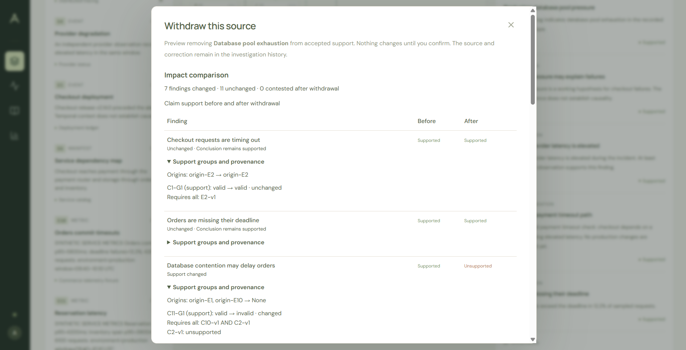
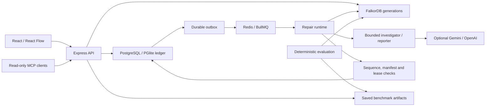

# Aftermath

**When evidence changes, incident reports should change with it.**

Aftermath traces incident findings to their evidence, previews the impact of withdrawing a source, and repairs affected conclusions while preserving independent support. FalkorDB executes Cypher to evaluate support; optional AI investigators and reporters work through bounded, audited tools.

[](docs/images/withdrawal-preview.png)

_Before confirming a withdrawal: the commerce preview identifies 7 changed findings and 11 unchanged findings, with expandable support-group explanations._

## See the workflow

1. **Trace a finding.** Explore evidence, AND premises and alternative support in the [evidence graph](docs/demo.md#screenshots).
2. **Preview a withdrawal.** Compare claim status, provenance, citations and related services before changing the incident.
3. **Repair the report.** Confirm the correction, wait for background repair, then compare [preserved and revised conclusions](docs/images/repaired-report.png).

Run locally with `npm ci` followed by `npm run dev`, then open http://127.0.0.1:5173. Leave provider variables unset for the deterministic fixture demo. See the [walkthrough and screenshots](docs/demo.md) or run `npm run demo:withdrawal-preview` for an isolated, automated lifecycle demonstration. Local setup and service requirements are detailed below.

For submission positioning, demo evidence and operational limits, see [submission notes](docs/submission.md).

## Current scope

The application provides validated core incident, evidence, claim, correction, and report contracts; an independently testable TypeScript support evaluator; immutable report formatting; and deterministic unit-test fixtures. The Express backend exposes incident investigation and read-only MCP tools; the React workspace provides evidence and service maps, correction workflows, report history, and activity inspection. FalkorDB projects and evaluates the evidence graph, service topology, and diagnostic availability and coverage. SQL persistence now provides a transactional incident and event ledger. Background repair runs through BullMQ and a dedicated worker. Bounded investigator and reporter agents produce validated, cited proposals. The saved benchmark dashboard compares deterministic report-selection policies. Registered diagnostic commands add deterministic synthetic observations.

## Architecture



SQL owns durable commands and history; graph generations provide derived reasoning. A separate worker needs shared services, while the default local API owns the embedded engines and worker runtime. See [actual Cypher queries](docs/graph-model.md), [demo and troubleshooting](docs/demo.md), and [release verification](docs/release-verification.md).

## Core model

`@aftermath/contracts` exports TypeScript types inferred from strict Zod schemas. The schemas validate data shape, while `validateGraph` in `@aftermath/domain` checks references, unique artifact/group identities, cycles, and the twelve-level dependency bound. A time window is an exact scope label, not a date interval inferred from source text.

`evaluateSupport` requires every premise within a support group; alternative groups are OR choices. Only active evidence and supported claim premises in the same environment and time window are admissible. Valid opposition makes an otherwise supported finding contested; contested findings cannot support descendants. Origins are deduplicated across surviving positive support, without claiming statistical independence.

`makeReport` produces a new revision with initial, preserved, or revised statements and a validation epoch. It validates evaluation coverage, keeps earlier reports unchanged, and distinguishes unsupported, contested, and pending findings. Its optional fifth `createdAt` argument allows reproducible report timestamps.

`createDomainFixture` in `@aftermath/fixtures` returns fresh deterministic test objects for the small checkout support graph. Its fixed ID and synthetic observation timestamps are test data, used for reproducible tests. `createIncident()` adds the small operational topology and recipe metadata; `createCommerceIncident()` supplies the complete commerce workload. Registered diagnostic execution adds hidden synthetic observations only after an accepted command.

## FalkorDB graph reasoning

`@aftermath/graph` exports `EvidenceGraph`. `await EvidenceGraph.open()` starts the pinned embedded FalkorDB engine; `EvidenceGraph.open(undefined, url)` connects to a remote service. Always call `close()` to delete owned generations and release the connection. Local execution needs permission to create Unix sockets and the installed native platform binary. Remote connection failures reject; there is no local fallback or TypeScript evaluation fallback.

Each incident/event sequence receives a private generation. Projection snapshots its inputs, batches evidence, claims, groups and corrections, evaluates dependency layers, projects service and diagnostic relationships, then sets `Projection.ready=true`. Concurrent readers share that build. Reads check readiness; failed builds reject and retry in a new generation. Callers must increment `eventSeq` whenever incident state changes. Generations remain cached until close; crash cleanup and bounded eviction remain future operational concerns.

| Graph model                                                    | Meaning                                                                                       |
| -------------------------------------------------------------- | --------------------------------------------------------------------------------------------- |
| `EvidenceVersion`                                              | Exact source version, status, scope, provenance and descriptive payload                       |
| `ClaimVersion`                                                 | Claim scope and Cypher-computed evaluation status                                             |
| `SupportGroup`                                                 | Explicit support/opposition polarity, rule, validity and rejection reasons                    |
| `Correction`                                                   | Withdrawal reason linked to an exact withdrawn evidence version                               |
| `ClaimVersion -HAS_SUPPORT-> SupportGroup -REQUIRES-> premise` | Ordered AND premises; OR across positive groups; valid opposition contests supported findings |
| `ClaimVersion -DERIVED_FROM-> premise`                         | Dependency traversal for impact, including opposition                                         |
| `Correction -RETRACTS-> EvidenceVersion`                       | Persistent projection of the supplied correction record                                       |

The parameterized queries in [queries.ts](packages/graph/src/queries.ts) compute admissibility, scope matching, origin deduplication and claim status from actual relationships. TypeScript only schedules up to twelve dependency layers and formats returned rows. Claim payloads omit membership arrays; readback reconstructs them from edges. Graph-view claim status uses the computed result, even if supplied incident evaluations are stale. `impact()` returns dependency paths, and `corrections()` reads retraction relationships; neither performs repair or SQL mutation.

Run `npm run test:graph` against the real embedded engine. Tests compare results to the independent domain oracle, deliberately alter graph premises and polarity, and cover withdrawal, alternatives, contested descendants, isolation, readiness, retry, cleanup and unavailable services. These tests make no model calls. The pinned engine requires computing group reasons in a Cypher variable before assigning both reasons and validity; reading a just-assigned property in a following `SET` produced incorrect results during verification.

## Service topology and diagnostics

`serviceImpact(incident, serviceId)` returns the graph-projected topology, incoming blast radius with shortest paths, and FalkorDB PageRank scores. `DEPENDS_ON` points from caller to dependency. Blast radius identifies potential exposure, not observed failure; PageRank describes dependency importance, not causal confidence. Equal shortest paths use a stable service-ID tie-break based on graph-computed distances.

`diagnostics(incident)` reads `DiagnosticRecipe -RUNS_ON-> Service`, `-CHECKS-> ClaimVersion`, and `-NEEDS-> EvidenceVersion` relationships. Evidence and claims link to services through `ABOUT`; absent claim service IDs are derived from evidence dependency paths. Every prerequisite must be active and match the recipe scope (taken from its first informed claim). Completed recipes are unavailable. Invalid references and topologies exceeding 128 services or 512 dependencies reject projection before publication.

Coverage includes unsupported or contested findings connected to the recipe's service through directed dependency paths. Each claim contributes its shortest applicable path once. The ranking score is `(covered claims + 0.1 × sum(1 / path node count)) / (1 + estimated cost)`, with unavailable/completed recipes scoring zero and recipe IDs breaking ties. Cypher computes availability and reachable paths; TypeScript deterministically formats paths and applies this formula. No fixture-specific rank order is encoded.

The deterministic commerce fixture includes **24 services, 34 dependencies, 17 observations and 18 claims**. Database-evidence withdrawal invalidates dependent explanations while retaining an independently supported order finding. The three recipes contain metadata only; their hidden observations are absent from the initial graph. These fixtures use fixed test identities and synthetic timestamps, used for reproducible tests.

`npm run test:graph` runs both graph and diagnostic suites against the real embedded engine. Generation caching and cleanup limitations described above still apply.

## Durable incident ledger

`Ledger.open(path)` uses local PGlite; `Ledger.open(undefined, databaseUrl)` uses PostgreSQL. Startup applies five versioned SQL migrations in one transaction, using a PostgreSQL advisory lock to serialize concurrent initialization. Initialization failures reject and close the database connection.

SQL stores the authoritative incident snapshot as JSONB, plus ordered domain events and idempotency responses. Creation and each accepted command commit their state and event together. This is a snapshot-plus-event ledger: events describe changes, rather than serving as a standalone replay format. Evidence, claims, corrections and immutable report revisions are retained within the incident snapshot. `get()`, `list()` and `events()` read durable SQL records.

The ledger uses application-enforced history invariants: `assertHistory` and `validateIncident` check evidence history, report immutability and contiguous incident events inside transactional command processing. SQL constraints protect job/audit relationships and valid states, but no database triggers enforce all invariants inside the JSONB incident snapshot. Direct SQL writes can bypass these application checks. This keeps the nested incident model in one validation layer across PGlite and PostgreSQL, at the cost of relying on trusted application writes; database-level enforcement remains future hardening.

`mutate()` locks the incident row, returns a prior response for an identical command key/fingerprint, and rejects conflicting keys or stale expected sequences. Callers must fingerprint all command parameters. It prevents rewriting existing evidence payloads, claim premises, corrections, reports or events; new evidence versions must advance the source version. Reasoning-input changes advance the evidence epoch and mark evaluations and the report for review. `withdraw()` records the exact withdrawn version and reason; `appendEvidence()` retains prior versions. Both atomically schedule a pending repair task and outbox record.

`publish()` accepts a report prepared outside the transaction. Its gate checks the expected incident sequence, projected sequence, evidence epoch, input report version and canonical artifact hashes (including topology and recipe metadata). It appends the new report with its graph-generation manifest and preserves old reports. The storage layer does not evaluate graph support or verify a graph generation remotely; its trusted caller supplies actual FalkorDB results. Direct publication rejects any intervening command. Background publication additionally verifies the owning attempt and live lease; only defined lifecycle and model-audit events may advance the sequence without invalidating unchanged inputs.

Repair-task, attempt, outbox, model-call and tool-call tables provide durable relationships and audit storage. The worker executes deterministic repairs and dispatches durable outbox deliveries. Model requests use persisted budgets and bounded provider execution. Audit-table tests insert synthetic records through SQL and verify foreign-key enforcement.

Run `npm run test:storage` for PGlite persistence and SQL/FalkorDB integration tests. Run `npm run test:postgres` for the same checks plus independent PostgreSQL-client concurrency. The PostgreSQL runner starts and removes a private temporary cluster using `PG_BIN` (default `/usr/lib/postgresql/16/bin`), or uses an explicitly supplied `STORAGE_TEST_DATABASE_URL`. Use a dedicated test database: the suite creates test incidents and audit records. Both integration modes require permission to create database sockets. No paid APIs are used.

## Evidence withdrawal impact preview

Before confirming **Withdraw source**, inspect the FalkorDB-derived before/after comparison: claim statuses, support and opposition groups, provenance, citations requiring review, report conclusions, and related service paths. Independent alternatives can preserve a conclusion even when one support group changes. A citation to withdrawn evidence still requires review.

Previews use disposable graph projections and leave SQL, corrections, reports and jobs unchanged. Each result identifies its incident sequence, evidence epoch, report version and snapshot fingerprint. The dialog blocks confirmation while loading, unavailable or stale; confirmation checks the submitted preview under the SQL incident lock. Existing API callers may still use sequence-checked withdrawal without a preview.

Run `npm run demo:withdrawal-preview` for an isolated, assertion-checked HTTP demo using actual local FalkorDB, PGlite and BullMQ, with no provider configuration. It verifies alternative support, stale rejection and confirmed repair, then removes its temporary data. See [the feature guide](docs/withdrawal-preview.md) for API requests, architecture, browser walkthrough, reproducible checks and limitations.

## Correction and background repair

A trusted caller submits an already-authorized correction with `ledger.withdraw(incidentId, evidenceId, reason, expectedSeq, idempotencyKey)`. The ledger atomically retains the withdrawn version, records the correction, advances sequence/epoch, marks the report for review, and schedules one repair task with an outbox delivery. The HTTP boundary validates commands and rejects foreign browser origins. It is a trusted local workspace, without multi-user authentication; the queue cannot submit corrections.

`RepairProcessor` reads the complete ready FalkorDB generation and follows `DERIVED_FROM` paths from corrected evidence. It evaluates all support groups, identifies affected findings and surviving alternatives, and formats a new report while preserving unchanged statement text. It never substitutes the TypeScript evaluator after a graph failure. Report publication checks input sequence, evidence epoch, prior report version, artifact hashes, graph-generation consistency, active attempt identity and lease expiry in a SQL transaction. Duplicate completion is idempotent. Old reports and correction records remain intact.

`RepairRuntime` uses BullMQ for delivery and SQL for ownership. It polls the durable outbox, recovers expired leases, and replays deliveries lost during Redis restart. Workers renew leases while preparing reports. Failed work receives at most three attempts with exponential delays; exhausted work leaves the report under review with an explicit error. An explicit retry command can create a new task. Held previews retain their original proposal and must pass the same publication gate on resume.

Queue Redis is separate from FalkorDB. `queueConnection()` starts a private temporary Redis with persistence disabled and `noeviction`; SQL remains the recovery source. A Redis URL supports credentials, database selection and TLS. Embedded PGlite is owned by a single process, which can run an in-process `RepairRuntime`; a separate worker requires shared PostgreSQL, FalkorDB and Redis.

Run `npm run test:repair` for deterministic job, Redis recovery and worker tests. `npm run test:postgres` also exercises competing PostgreSQL clients and an actual separate worker process. The tests invoke no AI provider or production diagnostic.

## Backend and graph inspection

The Express API separates routing and validation (`app.ts`), incident orchestration (`service.ts`), read-only MCP transport (`mcp.ts`), and resource lifecycle (`runtime.ts`). SQL remains authoritative; graph reads retry when an incident sequence changes. A failed graph read returns an explicit degraded snapshot or a service error, never a successful substitute evaluation.

Routes under `/api/incidents` list and create incidents with `scenario: "checkout"` or `"commerce"`. `/api/incidents/:id` returns the investigation snapshot. Its read endpoints include `evidence`, `evidence/:evidenceId`, `claims`, `claims/:claimId`, `support`, `graph`, `topology`, `service-impact/:serviceId`, `diagnostics`, `reports`, `repairs`, and `events?after=0`.

POST commands at `evidence/:evidenceId/withdrawals`, `repairs`, `held-reports`, `repairs/:taskId/resume`, `diagnostics/:recipeId`, `investigations`, and `sessions` require `expectedEventSeq` and an `idempotencyKey` of 8–200 characters. Withdrawal also requires a reason of 5–1000 characters. Stale commands return 409; invalid requests return 400; unavailable services return 503. Diagnostic recipes are synthetic fixture operations, not production probes. Sessions capture correction memory without invoking an AI provider.

`POST /api/mcp` supports stateless JSON Streamable HTTP with protocol version `2025-06-18`. Clients accept both `application/json` and `text/event-stream`; responses are JSON, notifications return 202, and GET/DELETE return 405. The only tools are `list_incidents`, `inspect_support`, `rank_diagnostics`, and `service_blast_radius`. Arguments are strictly validated, output is capped at 256 KiB, and no arbitrary Cypher or mutation tool is exposed. Tool failures return `isError: true`.

The default server binds to loopback. Browser commands are restricted to configured local origins; this is not authentication for public deployment. No provider credentials are needed. `npm run test:api` checks HTTP behavior, generation races, correction/repair, MCP protocol handling, server startup and durable restart recovery with real local engines. The PostgreSQL suite also runs API integration checks.

## Investigation workspace

The React/TypeScript interface uses React Flow for interactive evidence and service graphs. Select an incident, inspect source content, scope and provenance, or select a finding to query its current graph support. Support groups show AND premises and OR alternatives; opposition and rejected groups remain inspectable. Graph failures stay visible while durable evidence and historical reports remain readable.

Withdrawals require a reason and use sequence-checked, idempotent commands. The workspace polls repair progress, displays preserved and revised findings, and retains every report version with a revision diff. Activity shows worker attempts, publication results, and held-report controls. Memory opens a fresh correction-retrieval session. Incident selection survives reload; obsolete poll responses cannot replace a newly selected investigation.

The agent activity panel renders the audit summaries available from the backend. Its run control enables an explicitly configured provider, shows usage and failover, and opens recorded model requests and responses. Saved benchmarks are available independently through the Benchmarks tab.

`npm run test:web` runs Chromium end-to-end checks against an isolated API, PGlite, FalkorDB, and Redis, using temporary storage and ports 4001/5174. Install Chromium with `npx playwright install chromium` if unavailable; Linux may also require browser system libraries. Tests cover desktop/mobile recovery, alternative support, contested findings, commerce diagnostics, held-work rejection, historical reports, incident switching, and failure states. Browser artifacts are ignored by Git. API-client unit tests run with `npm test -- tests/web-api.test.ts`. No paid APIs are used.

## Bounded investigation agents

`@aftermath/agents` separates provider transport, the bounded tool loop, and citation validation. Gemini uses native function calls; OpenAI uses the Responses API with an explicitly configured model. Provider keys remain server-side and are excluded from persisted configuration and request bodies. Transport failures retain unknown usage rather than reporting zero; returned credentials are redacted from provider responses. No SDK performs hidden retries.

Leave provider settings unset for deterministic local operation. To enable live agents, set `LLM_PROVIDER=gemini` and `GEMINI_API_KEY`, or `LLM_PROVIDER=openai`, `OPENAI_API_KEY`, and `LLM_MODEL`. Gemini defaults to `gemini-3.5-flash-lite`; availability and quotas depend on the provider account. `GEMINI_API_KEY_FALLBACK` optionally supplies a distinct backup for the same model. An attempt can switch once after a retryable network, timeout, 408, 429, or server failure; each request consumes the persisted task budget. Authorization, malformed output and citation errors do not trigger credential failover.

Configuration alone does not activate agents for a new incident. **Run AI investigation** sends the sequence-checked, idempotent `POST /api/incidents/:id/investigations` command and pins the configuration. Subsequent corrections on that incident also invoke agents. Live requests can incur provider charges. A dedicated worker must have the incident's recorded provider and model configured; a mismatch fails visibly instead of substituting fixture output.

The investigator reads evidence, graph support, correction memory and ranked diagnostics through validated gateways. It may inspect service impact once per context and execute at most one registered synthetic diagnostic per attempt. Diagnostic execution uses a transactional ledger command and refreshes the graph context. There is no arbitrary Cypher, shell, or provider-selected mutation. Supported findings must cite a complete admissible support group, including underlying evidence for claim dependencies. Unsupported and contested findings receive application-owned notices. The reporter may rewrite only selected findings, preserving unaffected wording and immutable report history.

Calls are bounded by a task-wide SQL budget (4–20 calls), output limit (256–8192 tokens), context limit (8000–128000 bytes), and timeout (1–120 seconds). Invalid tool proposals stop after two rejections. Protocol versions v1–v4 remain readable; new investigations use v4. Provider requests are reserved before dispatch and audited separately from validated tool results. `model-calls/:callId` and `tool-calls/:callId` expose incident-scoped audit details. Publication checks the original sequence, graph generation, evidence epoch, artifacts, report version and lease, allowing only defined lifecycle and model-audit events between reads. Stale results cannot publish.

`npm run test:agents` uses scripted providers and intercepted HTTP responses with actual local SQL and FalkorDB. `npm run test:postgres` additionally exercises agent persistence on PostgreSQL. `npm run test:web:agents` starts a separate isolated stack on ports 4002/5175 with a test-only scripted provider, covering activation, audits, report publication and correction repair through the browser and BullMQ. These checks make no paid model requests. Live provider availability and model output quality require separately authorized verification.

## Deterministic evaluation and saved benchmarks

`@aftermath/evaluation` contains 41 structural cases from 15 motifs, six malformed-graph cases, and five diagnostic conditions. Each case specifies independent expected support states, origin counts, affected claims and required report reviews. Coverage includes AND/OR support, surviving alternatives, stale citations, opposition, scope corrections, replacement evidence, copied provenance and bounded dependency depth. Snapshot content/scope changes are simulated evaluation inputs; they do not bypass the append-only incident ledger in the application.

The three policies are **full rerun** (request every statement), **descendant invalidation** (request graph descendants), and **Aftermath** (request statements whose support, citations or cited artifacts require review). All three evaluate the full support graph. FalkorDB supplies the measured support and impact results; the TypeScript domain evaluator provides an independent parity check. Reports use seeded prior wording and deterministic formatting, with no model invocation.

```bash
npm run test:evaluation
npm run benchmark -- --seed=7 --repetitions=3 --projection=cold
npm run benchmark -- --seed=7 --repetitions=3 --projection=warm
npm run benchmark:diagnostics
```

Structural runs write `results.json`, `trials.csv`, `cases.json`, `metadata.json`, and `summary.md` under `DATA_DIR/benchmarks/run-*` (default `.data/benchmarks`). Failure artifacts retain execution errors. The seed reproduces case/method order; case and source SHA-256 hashes identify inputs and code. Recorded HEAD identifies the checkout, while source hashes also cover uncommitted implementation changes. Timestamps and elapsed times are actual run observations and are not deterministic.

Benchmark comparisons describe statements flagged for re-review; fewer flagged statements are not evidence of lower LLM token usage or cost. Any reduction claim must refer to an executed run and its comparison strategy.

Metrics report support/origin accuracy, required-review precision and recall, preservation of eligible affected statements, unsupported assertions, revision counts and local elapsed times. Aggregate ratios sum numerators and denominators; zero denominators are N/A. Failed trials remain included. Cold times include corrected graph projection; warm runs prepare each graph before timing and record preparation separately. Initial report preparation is excluded. These are development fixtures, not held-out incidents. No token savings, production costs, AI prose quality, or end-to-end worker performance are measured.

The diagnostic command uses actual FalkorDB coverage, paths and prerequisite checks to rank the five reference conditions, executes only the selected registered synthetic outcome, and checks independent before/after states. It writes separate results under `DATA_DIR/diagnostic-evaluations/run-*`; it does not evaluate a model's diagnostic choices or production probe latency. The dashboard presents structural policy runs; diagnostic results are available in the CLI JSON output.

Read-only endpoints are `GET /api/benchmarks`, `GET /api/benchmarks/:runId`, and `GET /api/benchmarks/:runId/artifacts/:name`. The API validates schemas, trial completeness, outcomes and recomputed summaries, limits artifacts to 16 MiB, and refuses traversal, symbolic links and non-files. The UI selects one run at a time, filters and inspects trials, shows failures and provenance, and downloads exact saved artifacts. Viewing results never starts an evaluation. Incomplete and invalid runs stay visible; cold/warm datasets are not merged. Example numbers exist only in explicitly labeled test fixtures.

Evaluation requires the installed embedded FalkorDB binary, writable temporary/artifact directories and local socket permissions. Artifact API/browser checks additionally need HTTP listeners and Chromium. Structural and diagnostic CLI commands require no PostgreSQL, queue Redis, credentials or paid AI services. The full application and general integration suite retain their existing database and queue requirements.

## Local setup

Use Node.js 20.19 or newer and npm 10 or newer. npm 10.8.2 is recorded as the package manager. The dependencies include a pinned project-local Node 22 runtime used by npm scripts after installation.

```bash
npm ci
npm run dev
```

Vite serves the investigation workspace at http://127.0.0.1:5173. The API listens at http://127.0.0.1:4000; Vite proxies /api to it. First startup seeds a commerce incident.

To run the API or start the configured dedicated worker:

```bash
npm start
npm run worker
```

The API runs an in-process repair runtime with durable local PGlite and private FalkorDB and Redis by default. The worker requires `DATABASE_URL`, `FALKORDB_URL` and `QUEUE_REDIS_URL`; it stays running and closes its resources on SIGTERM or SIGINT. Use `npm run dev:api`, `npm run dev:web`, or `npm run dev:worker` for individual development processes.

No external database services, Docker, or provider credentials are required for local tests. Graph tests start the embedded FalkorDB engine and require permission to create local sockets. Installation requires registry access and may fetch native runtime/engine binaries. The Linux x64 engine has been tested; other platforms remain unverified.

Copy `.env.example` to a local `.env` to configure the API or worker. Both load it through dotenv. Never commit local `.env` files or credentials.

## Verification

```bash
npm run typecheck
npm test
npm run build
npm run format:check
npm run verify:workspace
npm run test:postgres
npm run test:web
npm run test:web:agents
```

Run `npm run test:core` for contract, domain, and deterministic-fixture tests. These cover support alternatives, opposition, provenance, scope, malformed dependency graphs, and report revisions. The workspace smoke suite also checks TypeScript source exports. Core tests do not start databases, queues, or models; the full suite starts PGlite, embedded FalkorDB and private queue Redis. The separate PostgreSQL run verifies independent-client locking. The build typechecks all source and writes the web bundle to `dist/web`; server entries run as TypeScript through tsx, using the workspace source exports.

Use `npm run test:watch` for Vitest watch mode, `npm run format` to format project files, and `npm run preview` to inspect the built workspace while the API runs on port 4000. After `npm run build`, `npm start` also serves the workspace and API together on port 4000. Existing instructions and planning records are excluded from automatic formatting.

## Workspace layout

| Path                  | Responsibility                                  |
| --------------------- | ----------------------------------------------- |
| `apps/api`            | Express API and application startup             |
| `apps/web`            | React/Vite investigation workspace              |
| `apps/worker`         | Durable background repair worker                |
| `packages/contracts`  | Shared types and validated contracts            |
| `packages/domain`     | Evidence and claim support semantics            |
| `packages/fixtures`   | Synthetic incidents and registered diagnostics  |
| `packages/graph`      | FalkorDB projections and graph reasoning        |
| `packages/storage`    | PostgreSQL/PGlite ledger and publication checks |
| `packages/repair`     | Report repair orchestration                     |
| `packages/queue`      | Redis/BullMQ delivery                           |
| `packages/agents`     | Bounded provider tools and report proposals     |
| `packages/evaluation` | Structural evaluation and acceptance cases      |

Dependencies are centralized in the root manifest. Shared packages export `src/index.ts` directly and are private workspaces. The runtime stack uses FalkorDB for relationship-derived reasoning, SQL for durable state, dedicated Redis/BullMQ for delivery, Express for HTTP, and React/React Flow for the browser.

Dependencies, caches, build output, local databases, benchmark artifacts, and provider traces are excluded from Git.

## Recovery and diagnostic acceptance

`npm run test:acceptance` exercises recovery, bounded diagnostic choices, stale proposals, durable checkpoints, and the HTTP lifecycle using scripted providers and actual local services. `npm run test:agents:live -- --list-diagnostics` lists scenarios offline. The live harness requires explicit `--allow-live` plus provider configuration; it can make paid requests and is not part of default verification. Recovery and diagnostic artifacts remain under `DATA_DIR` and outside Git. Scripted acceptance does not establish live model quality or provider availability.

## Acknowledgments

The developer specified the reconstruction milestones, required architecture and withdrawal-preview feature, and captured the local application screenshots. An AI coding assistant produced implementation, tests and documentation and executed automated checks under those instructions, using the supplied Aftermath project as an architectural reference. The developer also attempted a live Gemini investigation; its recorded calls timed out, so successful live-model behavior is not claimed.
