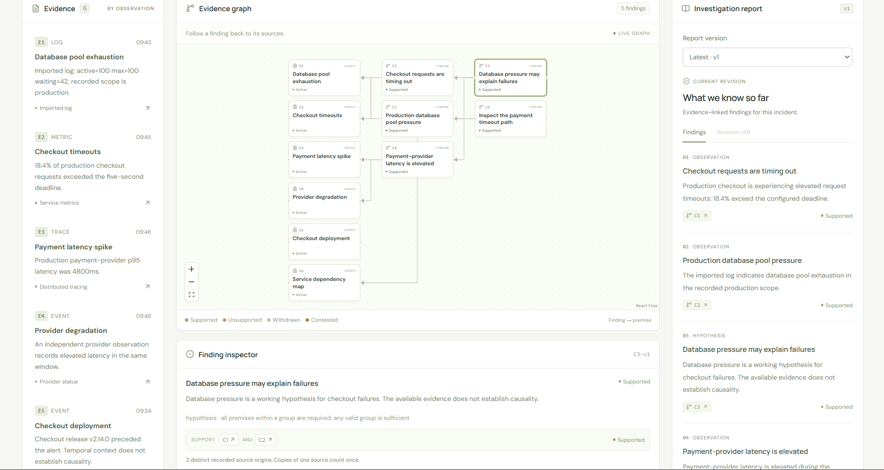
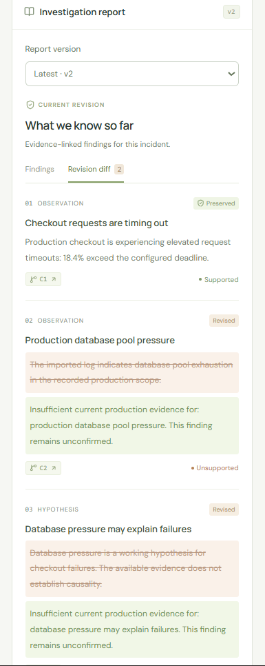

# Local demonstration and troubleshooting

Run `npm ci`, then `npm run dev`, and open http://127.0.0.1:5173. Leave provider variables unset for a deterministic demo. For one origin, run `npm run build` then `npm start` and open http://127.0.0.1:4000. Defaults use durable `.data` PGlite and private FalkorDB/Redis services.

## Demonstration

1. Create a checkout incident. Inspect evidence E1-v1, its environment, time window and origin; inspect C2-v1 and its support groups.
2. Open the evidence map and inspect AND premises, alternative groups and opposition. Inspect service paths and diagnostic rankings in the service map.
3. Click **Withdraw source** for E1-v1. Review the impact comparison: C2/C3 lose support while independent conclusions survive. Enter a reason and confirm **Withdraw evidence**. Observe the report enter review, then the queued repair publish a new report. C2-v1 becomes unsupported; independently supported findings survive.
4. Compare report revisions and inspect the correction event, worker attempt and publication outcome in activity. Old reports remain available.
5. Create a commerce incident to inspect the larger topology and execute a registered synthetic diagnostic. These observations are fixture data, not production probes.
6. Hold a report, apply another correction, then resume held work: obsolete output must be rejected. Inspect correction memory in a fresh session.
7. Run `npm run benchmark` and open Benchmarks to inspect actual saved local measurements. The dashboard does not invoke models.

## Screenshots

These user-captured screenshots show the application with fixture incidents. The preview uses the larger commerce scenario; the evidence graph and repaired report use checkout. They illustrate the workflow across those scenarios, rather than a single continuous run. They do not demonstrate a live Gemini invocation; live-provider testing requires separate configuration and authorization.

### Evidence graph: trace the premises

[](images/evidence-graph-preview.png)

The checkout workspace shows evidence, findings and report version 1 together. The selected C3 finding requires both C1 and C2; the inspector exposes its AND premises and source origins. Click the image to inspect the graph at full resolution.

### Withdrawal preview: compare before confirming

[](images/withdrawal-preview.png)

Withdrawing **Database pool exhaustion** in the commerce scenario previews 7 changed findings, 11 unchanged findings and no contested findings after withdrawal. Expanded support groups explain which premises stop supporting a conclusion. A changed finding can reflect changes in provenance or group validity as well as status.

### Repaired report: compare revisions

[](images/repaired-report.png)

After the checkout correction and repair, report version 2 preserves the checkout-timeout observation and revises the database-pressure findings. The revision diff shows previous text alongside updated conclusions; C2 is now unsupported. This focused crop captures the report comparison without requiring the entire workspace to remain visible.

For additional demo coverage, capture service paths, surviving alternative support and the stale-preview warning. Automated browser verification is documented separately in the [release verification report](release-verification.md).

## Withdrawal preview demo

Run `npm run demo:withdrawal-preview` for a fresh temporary local stack, assertions and automatic cleanup. This command uses no paid models and does not touch your `.data` workspace. The [feature guide](withdrawal-preview.md) includes a manual walkthrough, current API format and stale-preview behavior.

## API example

Create an incident:

```bash
curl -s http://127.0.0.1:4000/api/incidents \
  -H 'Content-Type: application/json' -d '{"scenario":"checkout"}'
```

Use the returned `id` and current `eventSeq` in commands; replace placeholders below. Read `/api/incidents/INCIDENT_ID`, `/support`, `/graph`, `/diagnostics`, `/reports` or `/events` first. A 409 means refresh the snapshot, inspect the change and submit an appropriate new command. Reusing an idempotency key is only valid for the identical original command.

```bash
curl -s http://127.0.0.1:4000/api/incidents/INCIDENT_ID/evidence/E1-v1/withdrawals \
  -H 'Content-Type: application/json' \
  -d '{"expectedEventSeq":1,"idempotencyKey":"demo-withdrawal-001","reason":"Observation came from the wrong environment"}'
```

This direct withdrawal example remains supported for API compatibility. To require a matching preview at confirmation, use the guarded workflow in the [feature guide](withdrawal-preview.md).

The example sequence of 1 must be replaced if the incident has advanced. Poll the incident snapshot until the report is current, or inspect `/repairs` for failure details.

## MCP example

```bash
curl -s http://127.0.0.1:4000/api/mcp \
  -H 'Content-Type: application/json' \
  -H 'Accept: application/json, text/event-stream' \
  -d '{"jsonrpc":"2.0","id":1,"method":"initialize","params":{"protocolVersion":"2025-06-18","capabilities":{},"clientInfo":{"name":"local-demo","version":"1"}}}'
curl -s http://127.0.0.1:4000/api/mcp \
  -H 'Content-Type: application/json' \
  -H 'Accept: application/json, text/event-stream' \
  -H 'MCP-Protocol-Version: 2025-06-18' \
  -d '{"jsonrpc":"2.0","id":2,"method":"tools/call","params":{"name":"list_incidents","arguments":{}}}'
```

`tools/list` describes `inspect_support`, `rank_diagnostics`, and `service_blast_radius`. Transport is stateless JSON Streamable HTTP; GET/DELETE are unsupported. Tools are bounded and read-only.

## Troubleshooting

| Symptom                                 | Check                                                                                                                                                        |
| --------------------------------------- | ------------------------------------------------------------------------------------------------------------------------------------------------------------ |
| Native graph or Redis startup fails     | Supported platform binary, writable temporary directory and socket permissions. Use explicit external service URLs on unsupported hosts.                     |
| Dedicated worker refuses startup        | Set all three shared URLs: `DATABASE_URL`, `FALKORDB_URL`, `QUEUE_REDIS_URL`. Never share one PGlite directory across processes.                             |
| Custom port cannot connect              | API and Vite read root `.env` HOST/PORT; restart both after changes. `APP_ORIGIN` must match the browser origin. Wildcard API binding is not authentication. |
| Graph unavailable / report under review | Restore the graph service and inspect repair attempts. Do not treat historical report text as current graph evaluation.                                      |
| PostgreSQL test cannot start            | Install PostgreSQL binaries or set `PG_BIN`; alternatively use a dedicated `STORAGE_TEST_DATABASE_URL`. Tests write records.                                 |
| Chromium unavailable                    | Install with `npx playwright install chromium` and required OS libraries. Browser tests require local listeners.                                             |
| Agent run unavailable or failed         | Configure server-side provider/model, inspect redacted audit errors and budget. No credentials are needed for default tests.                                 |
| Old publication rejected                | Expected behavior after new evidence, correction, changed inputs or lost lease. Inspect current state and schedule fresh work.                               |

The API is a trusted local workspace, not a publicly authenticated multi-tenant service. Keep credentials server-side; never prefix them with `VITE_`. Build output, local databases, traces and test artifacts are ignored. Graph cache eviction and crash-orphan cleanup remain operational work before long-running production use.
